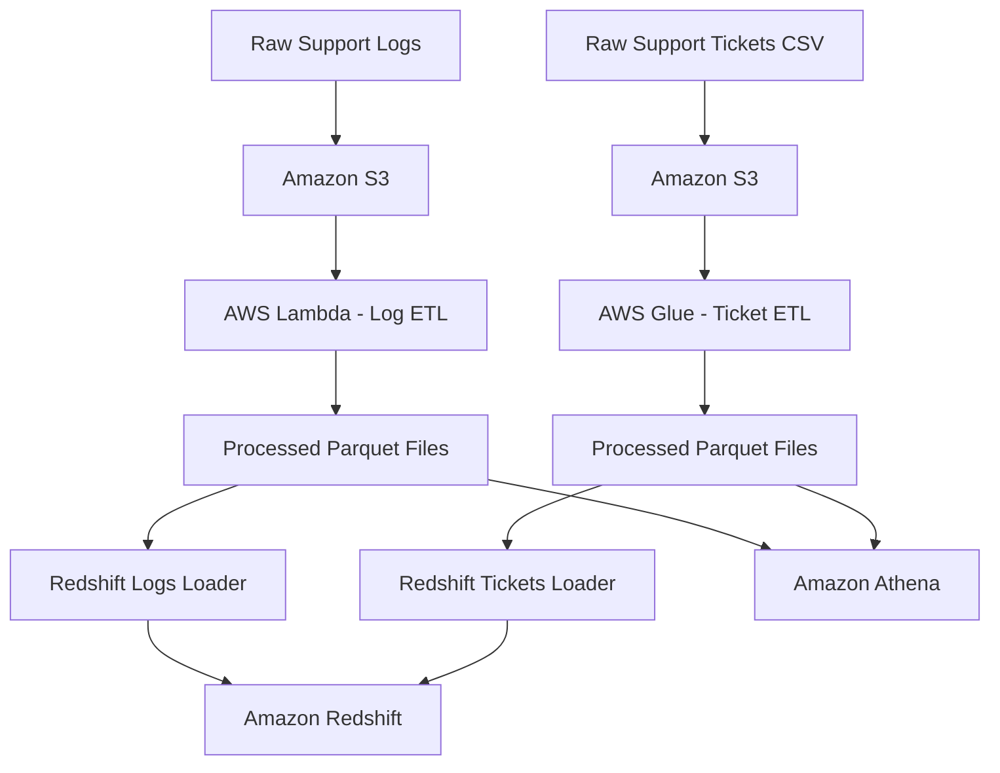

# Cares Plus – AWS Data Engineering Pipeline


## Project Overview

Cares Plus is a hands-on AWS Data Engineering project focused on processing customer support logs and support ticket data.

The project demonstrates how raw data can be collected, transformed, stored, and prepared for analytical use using Amazon Web Services (AWS).

The pipeline contains two main data-processing workflows:

1. **Support Logs Pipeline:** Uses Python and AWS Lambda to process raw support log files and convert them into structured Parquet files.
2. **Support Tickets Pipeline:** Uses AWS Glue and PySpark to transform raw CSV support ticket records into Parquet files.

The processed datasets are loaded into Amazon Redshift for SQL-based analysis. Amazon Athena is also explored for querying supported datasets directly from Amazon S3.

## Project Objectives

- Store raw and processed datasets in Amazon S3.
- Process support logs using Python and AWS Lambda.
- Transform support ticket data using AWS Glue.
- Convert processed datasets into Parquet format.
- Load processed data into Amazon Redshift.
- Explore SQL-based data validation and analysis.
- Understand how different AWS services work together in a data pipeline.

## Technologies Used

| Technology | Purpose |
|---|---|
| Amazon S3 | Cloud storage for raw and processed data |
| AWS Lambda | Serverless data processing and Redshift loading |
| AWS Glue | ETL and data transformation |
| Amazon Redshift | Cloud data warehouse |
| Amazon Athena | SQL queries directly against data in S3 |
| Python | Data processing and automation |
| PySpark | Distributed data transformation |
| Pandas | Data manipulation |
| PyArrow | Parquet file processing |
| SQL | Data loading, querying, and validation |
| Apache Parquet | Columnar data storage format |
| Git and GitHub | Version control and project documentation |

## Project Architecture

The project contains two main processing workflows.



*Note: The diagram represents the main processing components. Athena queries supported datasets directly in S3, independently of the Redshift loading process. It does not imply that every trigger and workflow has been fully automated.*

## Pipeline Description

### 1. Support Logs Pipeline

The support logs workflow involves:

1. Receiving raw log files in Amazon S3.
2. Triggering AWS Lambda to process the log data.
3. Extracting and structuring relevant log information using Python.
4. Converting processed data into Parquet format.
5. Storing processed files in Amazon S3.
6. Loading Parquet files into the `public.support_logs` table in Amazon Redshift.

### 2. Support Tickets Pipeline

The support tickets workflow involves:

1. Receiving raw CSV files in Amazon S3.
2. Using AWS Glue to process and transform ticket records.
3. Applying data type conversions and preparing the output schema.
4. Writing transformed data in Parquet format.
5. Storing processed files in Amazon S3.
6. Loading Parquet files into the `public.support_tickets` table in Amazon Redshift.

### 3. Redshift Data Loading

Two separate Python Lambda functions handle the Redshift loading operations:

- **`incremental_data_load_logs.py`:** Loads processed support log Parquet files into `public.support_logs`.
- **`incremental_data_load_tickets.py`:** Loads processed support ticket Parquet files into `public.support_tickets`.

Both functions use the Redshift `COPY` command to load data from Amazon S3 into their respective Redshift tables.

Database connection details and other configuration values are supplied through Lambda environment variables rather than being hard-coded in the source files.

### 4. Data Exploration with Athena and Redshift

Amazon Athena provides a way to run SQL queries directly against supported datasets stored in Amazon S3.

Amazon Redshift provides a data warehouse environment where processed datasets can be queried, validated, and analysed using SQL.

## Project Structure

```text
cares-plus-data-engineering-pipeline/
│
├── README.md
├── .gitignore
│
└── src/
    ├── support_logs/
    │   └── lambda_function.py
    │
    ├── support_tickets/
    │   └── etl_support_tickets.py
    │
    └── redshift_loaders/
        ├── incremental_data_load_logs.py
        └── incremental_data_load_tickets.py
```

## Challenges and Lessons Learned

During the development of this project, I encountered several technical challenges, including:

- Understanding the structure of S3 event notifications passed to Lambda functions.
- Configuring AWS Lambda to work with Amazon S3 events.
- Resolving missing event parameters and Glue job configuration issues.
- Correcting unexpected DataFrame index columns in Parquet files using PyArrow.
- Resolving data type and schema compatibility issues between Parquet files and Redshift tables.
- Configuring IAM roles and permissions for AWS service integration.
- Troubleshooting Redshift database connections and data loading errors.
- Validating records using SQL queries.

These challenges strengthened my understanding of cloud data engineering, data transformation, schema management, and troubleshooting.

## Current Project Status

This is a hands-on learning and portfolio project.

The individual data processing and Redshift loading components have been developed and tested during implementation.

Further improvements will focus on:

- End-to-end workflow validation.
- Duplicate-load prevention and reliable incremental loading.
- Stronger data quality checks.
- Pipeline monitoring and error handling.
- Workflow orchestration.

## Future Improvements

- Implement duplicate-load protection and more reliable incremental loading.
- Improve pipeline monitoring and error handling.
- Introduce additional data quality checks.
- Explore workflow orchestration using AWS Step Functions.
- Build a Power BI dashboard for support data analysis.
- Expand analytical queries and reporting.

## Project Article

I documented my learning experience and project journey in this Medium article:

[Building an AWS Data Engineering Pipeline: My Cares Plus Project Journey](https://medium.com/@adeniyisam4/building-an-aws-data-engineering-pipeline-my-cares-plus-project-journey-3643171eab1f)

## Author

**Adeyemo Oluwasegun David**

Aspiring Data Engineer | Mathematics Graduate | Python | SQL | AWS | Data Analytics
