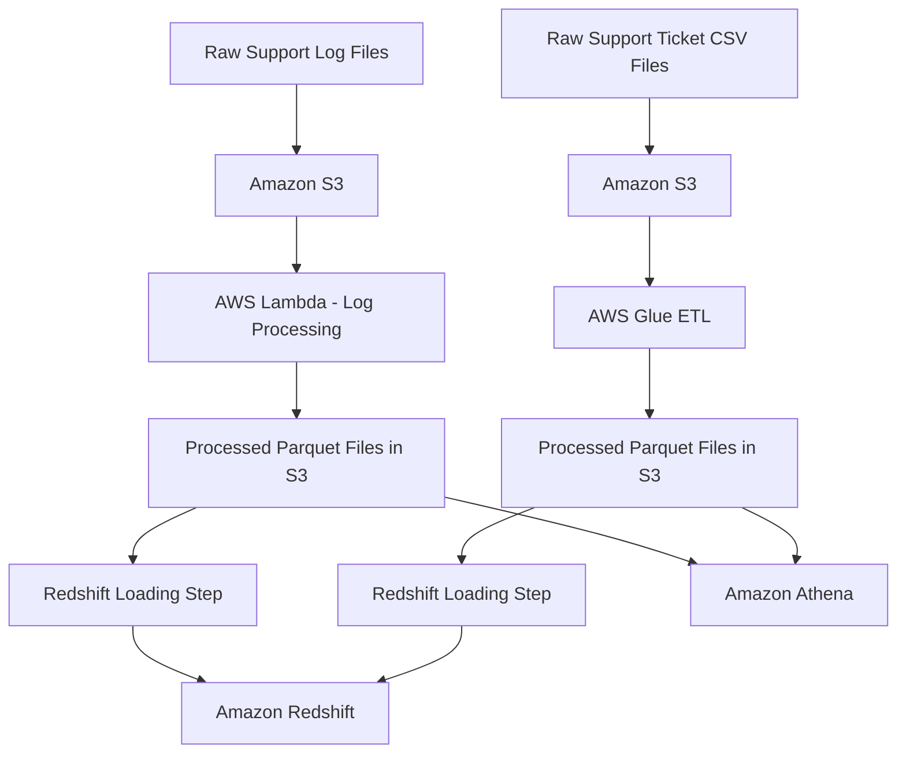

# Cares Plus – AWS Data Engineering Pipeline

## Project Overview

Cares Plus is a practical AWS Data Engineering project focused on processing support logs and support-ticket data.

The project explores how raw data from different sources can be collected, transformed, stored, and prepared for analytical use using Amazon Web Services (AWS).

It contains two main data-processing workflows:

1. **Support Logs Pipeline:** Processes raw log files using Python and AWS Lambda, then stores structured output in Parquet format.
2. **Support Tickets Pipeline:** Uses AWS Glue to transform raw CSV ticket records into Parquet files.

The processed data is loaded into Amazon Redshift for SQL-based analysis. Amazon Athena is also explored for querying supported datasets directly from Amazon S3.

## Project Objectives

- Store raw and processed datasets in Amazon S3.
- Process support logs using Python and AWS Lambda.
- Transform support-ticket data using AWS Glue.
- Convert processed datasets into Parquet format.
- Load processed files into Amazon Redshift.
- Explore SQL-based data validation and analysis.
- Understand how different AWS services work together in a data pipeline.

## Technologies Used

| Technology | Purpose |
|---|---|
| Amazon S3 | Cloud storage |
| AWS Lambda | Serverless processing and workflow coordination |
| AWS Glue | ETL and data transformation |
| Amazon Redshift | Data warehousing |
| Amazon Athena | SQL queries against data in S3 |
| Python | Data processing |
| Pandas | Tabular data manipulation |
| PyArrow | Parquet conversion |
| SQL | Data querying and validation |
| Apache Parquet | Columnar data storage format |

## Project Architecture

The project has two main processing workflows.

*Note: The diagram is a high-level representation. Athena queries supported data in S3 independently of the Redshift loading process.*

## Pipeline Description

### 1. Support Logs Pipeline

The support logs workflow involves:

- Receiving raw log files in Amazon S3.
- Processing log information using Python and AWS Lambda.
- Structuring the extracted information.
- Writing processed data to S3 in Parquet format.
- Loading processed files into Amazon Redshift.

### 2. Support Tickets Pipeline

The support tickets workflow involves:

- Storing raw CSV files in Amazon S3.
- Transforming ticket records using AWS Glue.
- Handling data types and preparing the output schema.
- Writing transformed data in Parquet format.
- Loading processed files into Amazon Redshift.

### 3. Data Exploration

Amazon Athena provides an additional way to explore supported datasets stored in S3 using SQL.

Amazon Redshift provides the warehouse environment for querying loaded datasets.

## Challenges and Lessons Learned

During the project, I encountered several technical challenges, including:

- Understanding the structure of S3 event notifications passed to Lambda functions.
- Correcting an unexpected DataFrame index column in Parquet output using PyArrow.
- Resolving data-type and schema compatibility issues between Parquet files and Redshift tables.
- Configuring AWS services and permissions to work together.
- Validating processed records and investigating unexpected query results.

These challenges improved my understanding of data transformation, schema management, cloud services, and debugging.

## Current Project Status

This is a hands-on learning and portfolio project.

The individual processing and loading components have been developed and tested during implementation. Further work will focus on strengthening end-to-end workflow validation, data quality checks, monitoring, and duplicate-load protection.

## Future Improvements

- Improve pipeline error handling and monitoring.
- Introduce stronger data-quality checks.
- Implement safeguards against duplicate data loading.
- Explore workflow orchestration with AWS Step Functions.
- Build a Power BI dashboard for support-data analysis.
- Expand analytical queries and reporting.

## Project Article

I documented my learning experience and project journey in this Medium article:

[Building an AWS Data Engineering Pipeline: My Cares Plus Project Journey](https://medium.com/@adeniyisam4/building-an-aws-data-engineering-pipeline-my-cares-plus-project-journey-3643171eab1f)

## Author

**Adeyemo Oluwasegun David**

Aspiring Data Engineer | Mathematics Graduate | Python | SQL | AWS | Data Analytics

